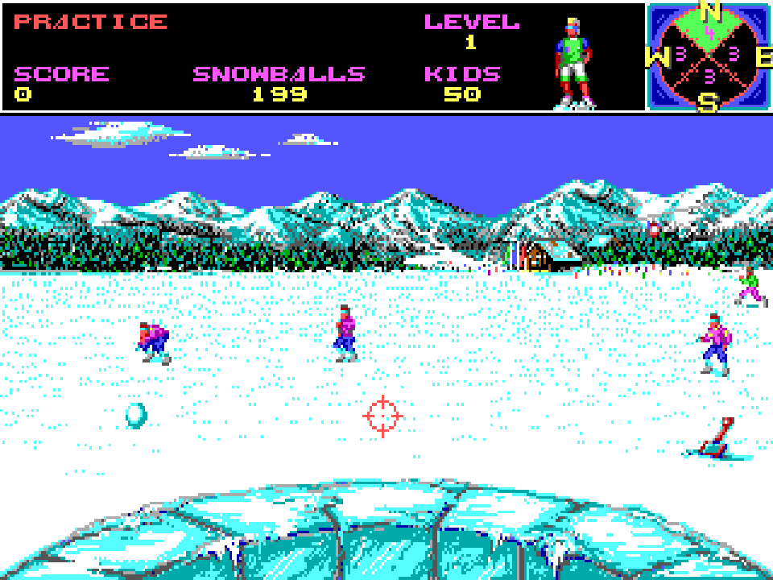
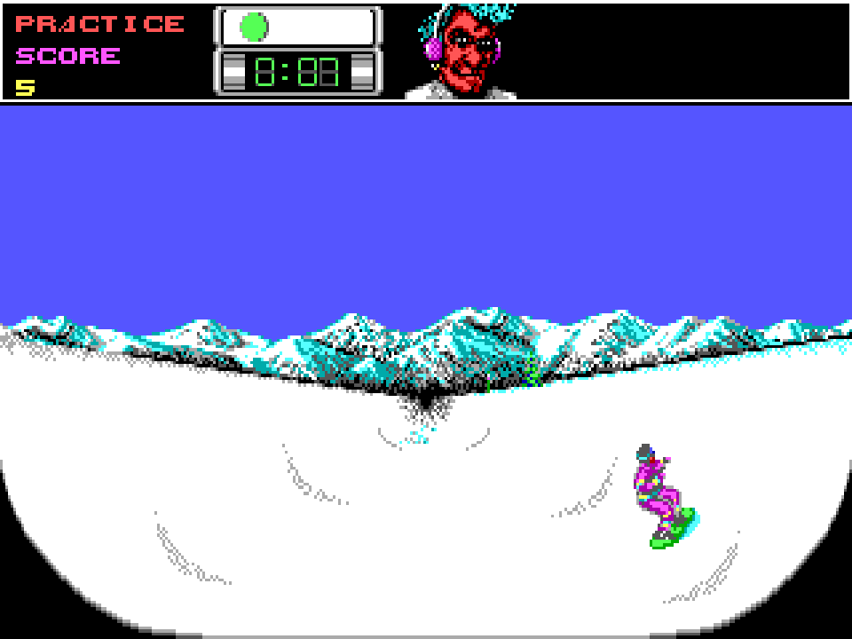

# SkyOfDie

[English](README.md)

SkyOfDie — нативная реализация на Go зимней спортивной игры **Ski or Die** для DOS. Пять дисциплин: Snowball Blast, Downhill Blitz, Acro Aerials, Innertube Thrash и Snowboard Halfpipe. Можно тренироваться или соревноваться, играя по очереди компанией до шести человек. В Innertube Thrash два участника играют одновременно.

Логика игры работает на Go без эмулятора во время исполнения. Исходные изображения, карты, музыка и эффекты включены в форматах PNG, JSON, Ogg Vorbis и WAV. Поддерживается сборка для Windows, Linux и macOS на amd64 и arm64.

| Snowball Blast | Snowboard Halfpipe |
| --- | --- |
|  |  |

## Управление

В магазине Родни выберите **SIGN IN**, чтобы ввести имена и назначить устройства управления, затем **GO COMPETE**. Для тренировки выберите **GO PRACTICE**. На карте курорта доезжайте до входа в нужную дисциплину; **COMPETE ALL** запускает все пять дисциплин в режиме соревнования.

В меню используются стрелки и Enter/Space. В регистрации подтвердите настройку, измените её стрелками влево/вправо и подтвердите ещё раз. Введите имя и подтвердите; строка **DONE** возвращает в магазин. Максимальная длина имени — десять символов.

### Клавиатура и геймпад

| Действие | Keypad One | Keypad Two | Дополнительные клавиши текущего игрока |
| --- | --- | --- | --- |
| Вверх-влево / вверх / вверх-вправо | Numpad 7 / 8 / 9 | R / T / Y | Верхний ряд 7 / 8 / 9 |
| Влево / вправо | Numpad 4 / 6 | F / H | Верхний ряд 4 / 6 |
| Вниз-влево / вниз / вниз-вправо | Numpad 1 / 2 / 3 | V / B / N | Верхний ряд 1 / 2 / 3 |
| Первая кнопка / подтверждение | Enter | A | Space |
| Вторая кнопка | Правый Shift | Z | Левый Shift |

Keypad One также принимает стрелки для четырёх основных направлений. **WASD** и **IJKL** — дополнительные варианты управления; для диагонали удерживайте две соседние клавиши. **5** верхнего ряда означает нейтральное положение. Буквенные клавиши определяются по физическому расположению. Space также подтверждает ввод имени.

WASD отключается во время дисциплины, если текущий игрок или одновременно играющий второй участник использует Keypad Two: так сохраняется кнопка A. IJKL, цифры верхнего ряда, Space, левый Shift и мышь остаются доступны текущему игроку. Второй участник использует назначенное устройство. **JOYSTICK A/B** работают через оси и первые две кнопки подключённых геймпадов.

| Место / дисциплина | Действия |
| --- | --- |
| Курорт | Влево/вправо — поворот; удержание первой кнопки — движение. |
| Snowball Blast | Направления перемещают прицел; первая кнопка бросает снежок. Вторая кнопка + основное направление переключает обзор. |
| Downhill Blitz | Вниз — разгон, вверх — торможение, влево/вправо — поворот. Первая кнопка + направление выбирает трюк, если позволяет рельеф. |
| Acro Aerials | На разгоне чередуйте влево/вправо. В полёте первая кнопка + направление выбирает трюк; отпустите направление для выхода из удерживаемой позы. |
| Innertube Thrash | Направления перемещают, ускоряют или тормозят. Первая кнопка + влево/вправо вращает участника; вторая кнопка атакует. |
| Snowboard Halfpipe | Влево/вправо — движение по хафпайпу. Первая кнопка + направление выбирает доступный трюк на дне, бугре или краю; отпустите направление для выхода из удерживаемой позы. |

### Мышь

- **Меню:** наведите указатель и нажмите ЛКМ. В регистрации нажмите на строку; повторный щелчок по активной настройке или колесо меняет значение. Нажмите на имя для ввода, затем подтвердите Enter/Space или щелчком.
- **Курорт:** удерживайте ЛКМ, чтобы поворачивать и двигаться к указателю; отпустите для остановки. Проводите лыжника по дорожкам вокруг зданий.
- **Снежки:** движение мыши задаёт прицел, удержание ЛКМ — броски. ПКМ переключает обзор по часовой стрелке; колесо вверх/вниз — предыдущий/следующий вид.
- **Остальные дисциплины:** положение указателя относительно центра окна задаёт одно из восьми направлений; центр — нейтральная зона. ЛКМ/ПКМ выполняют действия первой/второй кнопки.

Направления с клавиатуры или геймпада имеют приоритет над мышью. Для возврата управления мышью снова сдвиньте её. Средняя кнопка или **P** ставит игру на паузу. ПКМ в меню действует как Escape; на экране повторной попытки нажимайте **YES/NO**.

**Esc** открывает таблицу дисциплины в соревновании, вопрос о повторе в тренировке и запрос выхода в магазине/на курорте. **Ctrl+M** переключает звук, **F11** — полноэкранный режим, **F12** сохраняет скриншот. Настройки, рекорды и сделанные скриншоты хранятся в каталоге пользовательских настроек ОС, в папке `SkyOfDie`.

## Сборка и запуск

Установите **Go 1.25 или новее**. Выполните из корня проекта, где находится `main.go`:

```sh
go mod download
go run .
```

Для первой сборки нужен интернет для загрузки Go-зависимостей. Компилятор C и установленная DOS не требуются. В Linux необходима графическая сессия X11 или XWayland.

Сборка для текущей системы:

```sh
go run ./cmd/build
```

Сборка всех шести вариантов или одной выбранной платформы:

```sh
go run ./cmd/build -all
go run ./cmd/build -os windows -arch arm64
```

| Система | Результат для amd64 | Результат для arm64 |
| --- | --- | --- |
| Windows | `build/windows-amd64/SkyOfDie.exe` | `build/windows-arm64/SkyOfDie.exe` |
| Linux | `build/linux-amd64/SkyOfDie` | `build/linux-arm64/SkyOfDie` |
| macOS | `build/darwin-amd64/SkyOfDie.app` | `build/darwin-arm64/SkyOfDie.app` |

Сборщик встраивает иконку в Windows-приложение и создаёт пакет macOS с иконкой. Файлы иконки находятся в `assets/icon`.

По умолчанию используется звук PC Speaker. Для варианта AdLib запустите `go run . -adlib`. Другие параметры: `-nosound`, `-fullscreen`, `-scale 3`.

## Лицензии

Новый код на Go и иконка приложения распространяются по [лицензии MIT](LICENSE). Исходные изображения, звук, шрифт, карты, анимационные данные Ski or Die и скриншоты сохраняют права первоначальных владельцев и **не** подпадают под эту лицензию.
